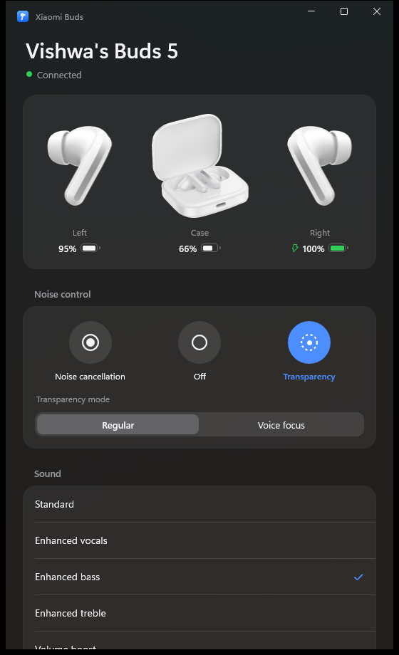
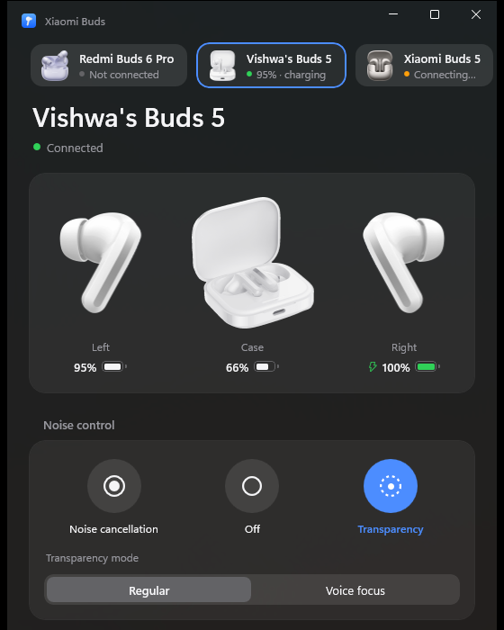

<h1 align="center">Xiaomi Buds</h1>

<p align="center">
  Control your Xiaomi and Redmi earbuds from Windows: battery, noise cancellation, sound presets, find my buds and more, without your phone.
</p>

<p align="center">
  <a href="../../releases/latest"><b>⬇ Download XiaomiBuds.exe</b></a>
  &nbsp;·&nbsp; Windows 10 / 11 (x64) &nbsp;·&nbsp; free and open source
</p>

<p align="center">
  
</p>

<p align="center">
  
  &nbsp;&nbsp;
  
</p>

## Features

- **Battery:** left bud, right bud and case, with a charging indicator, shown on the official product photo of your model.
- **Noise control:** Noise cancellation / Off / Transparency, plus noise-cancellation level and transparency mode on models that have them.
- **Sound presets:** for example Standard, Enhanced bass, Enhanced vocals, Enhanced treble and Volume boost.
- **Find my buds:** make the left bud, the right bud or both play a sound.
- **Settings:** in-ear detection, dual-device connection, auto-answer calls, adaptive ANC and adaptive sound, depending on the model.
- **Connect popup:** a "Dynamic Island" pill drops from the top of the screen when your buds connect. Hover over it to keep it open; click it to open the app.
- **Multiple earbuds:** all paired buds connect at the same time. Switch between them with the device bar at the top.
- **Rename** your buds; the name shows in the app, the popup and the tray.
- **Lives in the tray:** check battery and switch noise mode from the tray icon. Closing the window keeps the app running.
- Native Windows 11 design: Mica background, light and dark mode.

## Download and use

1. Pair your earbuds in **Windows Settings › Bluetooth**.
2. Download **`XiaomiBuds.exe`** from the [latest release](../../releases/latest) and run it.
   It's a single file and needs no installation; .NET and the Windows App SDK are built in.
3. Take the buds out of the case. They connect and the popup appears.

The first time you run it, Windows SmartScreen may say the app isn't recognised, because the exe isn't code-signed. Click **More info › Run anyway**.

## Supported earbuds

| Model | Support |
|---|---|
| Redmi Buds 5 | ✅ Tested on real hardware |
| Redmi Buds 3 Pro, 4 Active, 5 Pro, 6, 6 Pro, 6 Active, 6 Lite, 8 Active | ✅ Supported, with each model's feature list from Gadgetbridge |
| Redmi Buds 6 Play, 8, 8 Pro, 8 Lite · Xiaomi Buds 3, 3T Pro, 4 Pro, 5, 5 Pro | 🧪 Experimental: features are detected from what the buds report |
| Any other "Redmi Buds" / "Xiaomi Buds" | 🧪 Experimental (generic) |

Each model shows only the settings it really has. If you own an experimental model, please [open an issue](../../issues) with your `app.log` (see below), so it can move to "Supported".

## Multiple earbuds

Pair as many Xiaomi and Redmi earbuds as you like in Windows, and every pair is controlled at the same time:
- **Device bar:** with more than one pair paired, a chip per pair appears at the top, showing its photo, name and live battery. Tap one to switch.
- **Separate settings:** each pair keeps its own noise mode, sound preset, name and color.
- **Follows you:** the app opens on the pair you used last, and switches to a pair as it connects.
- **Tray:** the tooltip shows every pair's battery, and the menu has noise controls for each pair.

## Build from source

Requirements: Windows 10/11 and the [.NET 10 SDK](https://dotnet.microsoft.com/download) (`winget install Microsoft.DotNet.SDK.10`).

```
run.bat              # builds the app on first run, then starts it
run.bat --rebuild    # rebuild after changing the code
run.bat --tray       # start hidden in the tray

# single-file exe, the same as on the Releases page
dotnet publish src/XiaomiBuds/XiaomiBuds.csproj -c Release -p:SingleExe=true -o publish
```

Pushing a tag such as `v1.0.1` makes GitHub Actions build `XiaomiBuds.exe` and attach it to a new release.

Useful options:
- `--demo-island[=Model name]` previews the connect popup with sample data.
- `--demo-devices` adds two simulated pairs to preview the multi-device layout.

Logs and settings are saved in `%LOCALAPPDATA%\XiaomiBuds\` (`app.log`, `settings.json`).

## How it works

Xiaomi and Redmi earbuds expose a control channel over Bluetooth Classic RFCOMM (service UUID `0xFD2D`). After a SAFER+-based challenge/response handshake, the app exchanges small frames (`FE DC BA | type | opcode | length | seq | payload | EF`) to read battery and settings and to send commands. The protocol was reverse-engineered by the [Gadgetbridge](https://codeberg.org/Freeyourgadget/Gadgetbridge) project and ported to C# here.

```
src/XiaomiBuds/
  App.xaml(.cs)                     startup, single instance, --tray
  MainWindow.xaml(.cs)              window, device discovery, device bar, tray menu, popup
  Core/                             Bluetooth RFCOMM, paired-device watcher, tray icon,
                                    product-photo download cache, settings, log
  Devices/RedmiBuds/
    BudsModels.cs                   supported models and their features (add new earbuds here)
    BudsProtocol.cs, BudsAuth.cs    framing, parsers, commands, handshake
    RedmiBudsClient.cs              connect, authenticate, state, commands
    BudsController.cs               keep-connected loop and status
  Views/                            earbuds page, pairing page, connect popup, device chip
  Controls/, Styles/                iOS-style switch, segmented control, battery label; theme
```

Product photos belong to Xiaomi and are not stored in this repository. The app downloads each model's official photo from mi.com on first use and caches it. Offline, it shows a generic drawing instead.

## Contributing

Contributions are welcome:
- **Test a model:** run the app with your buds and open an issue with `%LOCALAPPDATA%\XiaomiBuds\app.log`.
- **Add a model:** add an entry in `Devices/RedmiBuds/BudsModels.cs`, with its features and the URL of its official product photo.
- **Fix bugs, polish the UI, translate:** open a pull request.

## Roadmap

- Custom 10-band equalizer and gesture remapping (already in the protocol for several models)
- Native Xiaomi Share file transfer from HyperOS phones
- Xiaomi watch and band support

## License and credits

Copyright © 2026 **Gadget Vishwa** · [gadgetvishwa.in](https://gadgetvishwa.in)

Licensed under the **GNU Affero General Public License v3.0 or later**; see [LICENSE](LICENSE).
The earbuds protocol and authentication are ported from [Gadgetbridge](https://codeberg.org/Freeyourgadget/Gadgetbridge) (AGPL-3.0-or-later, © 2024 Jonathan Gobbo and contributors).

Xiaomi, Redmi and the product photos are trademarks and copyright of Xiaomi. This is an independent community project, not affiliated with or endorsed by Xiaomi.

<p align="center"><b>Crafted By Gadget Vishwa</b></p>
